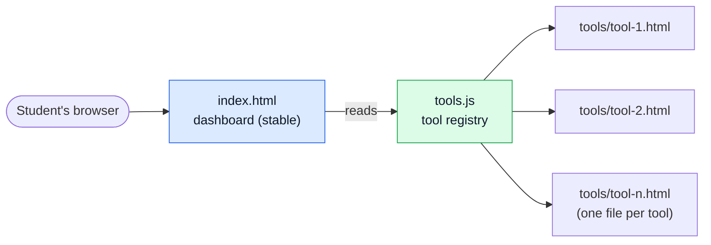

<div align="center">



<br>

**A free, ad-free toolbox for engineering students, built to replace the pile of browser tabs that every problem set requires.**

<br>

[](https://kingtheworldsayhipy.github.io/Student-Tools-/)
&nbsp;

&nbsp;

&nbsp;

&nbsp;


<sub>Built by an engineering student, with an AI pair-programmer, in small daily steps.</sub>

</div>

<br>

## 👀 The 30-second version

| | |
|---|---|
| **What it is** | A growing web app of calculators and converters that engineering and university students use every day |
| **Why I built it** | Studying engineering meant 10 to 20 open tabs per session. I wanted everything in one clean, fast place |
| **How it was built** | Deliberately with AI. I acted as product owner, architect, reviewer and tester; the AI acted as a very fast pair-programmer |
| **Stack** | Vanilla HTML, CSS and JavaScript. No framework, no build step, no backend, no paid services |
| **Where to look first** | [Live demo](https://kingtheworldsayhipy.github.io/Student-Tools-/) · [How I worked with AI](#-built-with-ai-on-purpose) · [Architecture](#-architecture) |

<br>

## 🧩 The problem

Anyone who has studied engineering knows the ritual. Halfway through a problem set you have one tab for Ohm's law, another for a hexadecimal converter, a unit converter buried in ads, and a GPA calculator that wants you to create an account.

Each site is fine on its own. Together they break your focus, and every one of them looks and behaves differently.

**Student Tools puts the most common ones behind one dashboard:** one search bar, one consistent interface, nothing to sign up for, nothing to install.

<br>

## 🤖 Built with AI, on purpose

I did not hide the AI in this project. It was the point.

I wanted to learn how far a student can get by **directing** an AI assistant well: giving clear requirements, questioning its choices, checking its work and shipping something real. I treated it like a very fast junior engineer who needs a precise brief and a careful reviewer.

<table>
<tr>
<th width="50%">What I did</th>
<th width="50%">What the AI did</th>
</tr>
<tr>
<td valign="top">

- Defined the problem and the audience
- Chose the architecture (see below)
- Set the rules: no frameworks, no paid services, no fake data, no insecure "admin page" on static hosting
- Decided to target **international** students and removed locale-specific content
- Reviewed every tool on screenshots, on desktop and phone sizes, and reported what looked wrong
- Deployed to GitHub Pages and debugged problems in production
- Chose what to build next, one tool and one improvement per day

</td>
<td valign="top">

- Wrote most of the code from my specifications
- Proposed options with trade-offs so I could decide
- Wrote test scripts that run each tool in a headless browser
- Cross-checked results against independent reference calculations
- Explained the "why" behind its choices so I could learn from them

</td>
</tr>
</table>

### What I learned about working with AI

1. **A clear brief beats a clever prompt.** Good results came from stating the goal, the constraints and what "done" means.
2. **Verify everything.** Plausible-looking output is not correct output. Numbers were checked against independent calculations before release.
3. **Ask for trade-offs, not just answers.** The best decisions came from comparing two options, not accepting the first one.
4. **Small daily steps compound.** One tool and one improvement per day produced a working product without ever breaking what already worked.
5. **Production teaches fast.** Once the site showed an empty dashboard because I had named a file `tool.js` instead of `tools.js`. The dashboard was built to fail visibly instead of silently, so I found the cause within minutes. Good error messages are a feature.

<br>

## 🛠️ The tools

> The live [dashboard](https://kingtheworldsayhipy.github.io/Student-Tools-/) is always the up-to-date list. This table highlights the tools available so far.

| Tool | What it does | Try it |
|---|---|---|
| **Ohm's Law Calculator** | Enter any two of voltage, current, resistance and power to get the other two. Unit drop-downs (µ, m, k, M) and the formulas used are shown | [Open](https://kingtheworldsayhipy.github.io/Student-Tools-/tools/ohm-law.html) |
| **Power Calculator** | DC power, AC power with power factor (single and three-phase), and energy use with electricity cost | [Open](https://kingtheworldsayhipy.github.io/Student-Tools-/tools/power-calculator.html) |
| **GPA Calculator** | Semester and cumulative GPA for US-style and custom scales, letter, percent or points input, and a goal planner | [Open](https://kingtheworldsayhipy.github.io/Student-Tools-/tools/gpa-calculator.html) |
| **Number System Converter** | Binary, octal, decimal, hexadecimal and any base from 2 to 36, with fractions, negatives, two's complement and step-by-step working | [Open](https://kingtheworldsayhipy.github.io/Student-Tools-/tools/number-system-converter.html) |
| **Truth Table Generator** | Type a Boolean expression and get its truth table, intermediate columns, minterms, maxterms, SOP/POS forms and an equivalence check | [Open](https://kingtheworldsayhipy.github.io/Student-Tools-/tools/truth-table.html) |
| **Engineering Unit Converter** | 15 quantities (length, pressure, energy, power, temperature, torque and more) with the conversion factor and the working | [Open](https://kingtheworldsayhipy.github.io/Student-Tools-/tools/unit-converter.html) |

<details>
<summary><b>Details worth a closer look</b> (click to expand)</summary>

<br>

- **Ohm's Law:** results can be shown in any unit, and every answer includes the formula and the calculation steps, so it works as a study aid and not only a calculator.
- **Power Calculator:** handles real-world cases such as three-phase systems and power factor, then turns energy use into a cost estimate.
- **GPA Calculator:** supports different grading scales used internationally. Entries are saved only in the user's own browser, never sent anywhere.
- **Number System Converter:** uses arbitrary-precision integers (`BigInt`) so very long numbers stay exact. Fractions that never terminate are clearly marked as cut off, not silently rounded.
- **Truth Table Generator:** includes a small expression parser with correct operator precedence. It accepts words (`AND`), symbols (`&`, `^`) or letters written side by side (`AB + A'C`), and points to the exact position of a typo.
- **Unit Converter:** temperature is handled with formulas (it has an offset), not a single factor, and impossible values below absolute zero are rejected. Conversion factors were checked against SciPy's physical constants.

</details>

<br>

## 🏗️ Architecture

The key decision: **one stable dashboard, one file per tool.** If one tool has a bug, the others keep working. Adding a tool never means editing the dashboard.



**Adding a new tool takes two steps and zero dashboard changes:**

1. Create the tool as its own file in `/tools`.
2. Register it in `tools.js`:

```js
{
  id: "my-tool",
  name: "My New Tool",
  category: "engineering",          // electrical | digital | academic | engineering
  status: "available",              // or "soon" for a Coming Soon card
  href: "tools/my-tool.html",
  description: "One short sentence shown on the card.",
  keywords: "words the search bar should match"
}
```

The dashboard builds its cards, category counts and search automatically from this list.

<br>

## ✅ Engineering decisions

- **Vanilla web stack.** No framework or build step. The whole site loads fast and can be read, understood and hosted anywhere for free.
- **Correctness first.** Exact integer arithmetic where precision matters, and half-up rounding where people expect it. Each tool was tested against independent reference calculations before release.
- **Safe by default.** User input is escaped before it is shown and is never evaluated as code.
- **Works on every screen.** Responsive layouts checked from 320 px phones to wide desktop monitors, with no horizontal scrolling.
- **Accessible basics.** Real labels, keyboard-friendly controls, visible focus, and live regions for results and errors.
- **Privacy by design.** No accounts, no database, no ads. Calculations run entirely in the browser.
- **Fails loudly, not silently.** If the tool list cannot load, the dashboard says so instead of showing an empty page.

<br>

## 🗺️ Roadmap

- [x] Dashboard with search and category filters
- [x] First tools shipped: Ohm's Law, Power, GPA, Number System, Truth Table, Unit Converter
- [x] Consistent design across all tools
- [ ] Privacy Policy and About pages
- [ ] A simple, privacy-friendly visitor counter
- [ ] Publish the test scripts in this repository
- [ ] More tools, one per day: ideas include a resistor colour-code decoder, a logic-gate simulator, and a matrix calculator

<br>

## 💼 What this project shows

For anyone reviewing this as part of a hiring decision, here is what I would like it to say about me:

- **I notice real problems and ship solutions.** The idea came from my own daily frustration, and it is live and usable.
- **I use AI tools responsibly and effectively.** I stay in charge of the decisions, verify the output and I am open about how the work was done.
- **I think in systems.** The modular design was chosen so the project can grow without becoming fragile.
- **I care about the user.** Clear errors, worked steps, responsive design and honest limits (for example, clearly marking truncated results).
- **I finish things and improve them in small steps.** A steady rhythm of one tool and one improvement per day.
- **I can explain my work in plain English.** That includes this README.

<br>

## 🚀 Run it locally

No install needed.

```bash
git clone https://github.com/kingtheworldsayhipy/Student-Tools-.git
cd Student-Tools-
# Option 1: just open index.html in your browser
# Option 2: serve it locally
python3 -m http.server 8000      # then visit http://localhost:8000
```

<br>

## 👋 About me

Hi, I'm **[King]**, an engineering student based in **[Gotthan]**. I am looking for **[internship / junior / graduate]** opportunities in **[ software, embedded systems, electronics]**, and I am open to relocating or working remotely.

📧 **[i have my discord on my main profile]** &nbsp;·&nbsp;  &nbsp;·&nbsp; 🐙 [GitHub](https://github.com/kingtheworldsayhipy)

<div align="center">
<br>

*If this saved you a few browser tabs, a ⭐ on the repo is always appreciated.*

</div>
